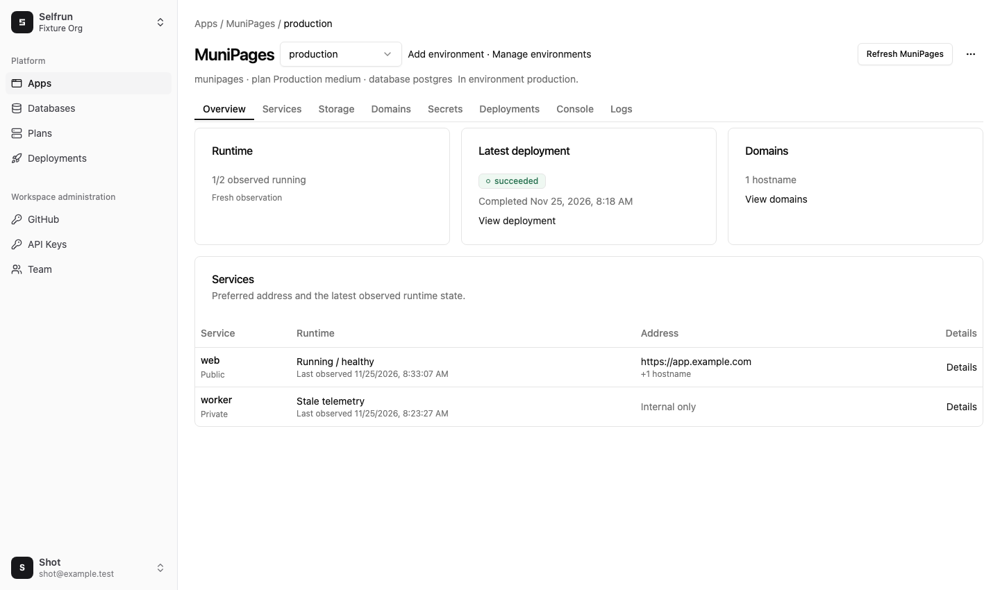
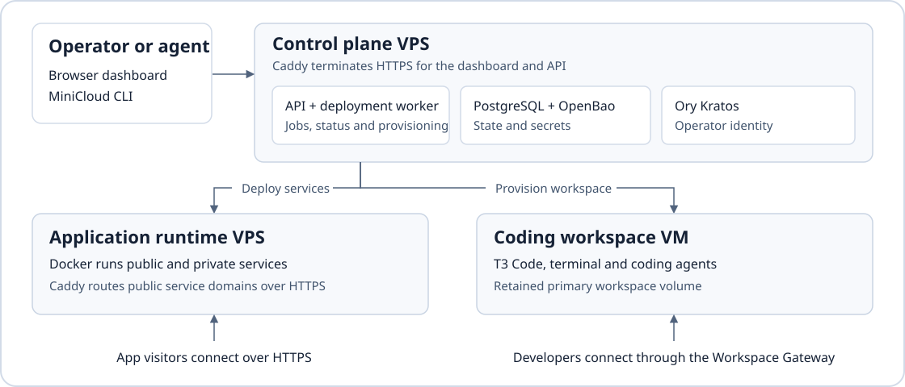
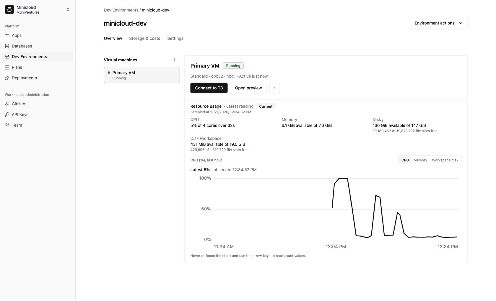
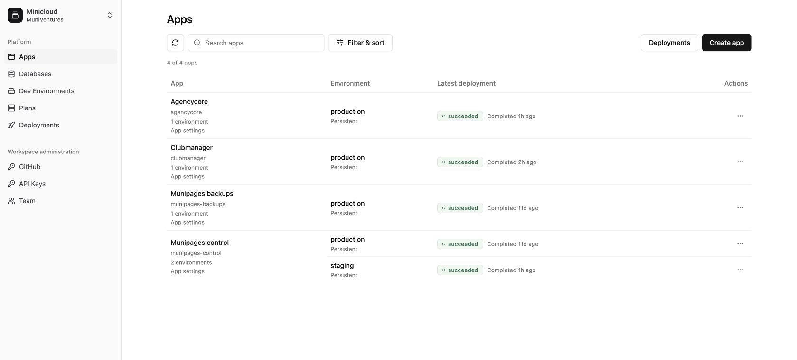
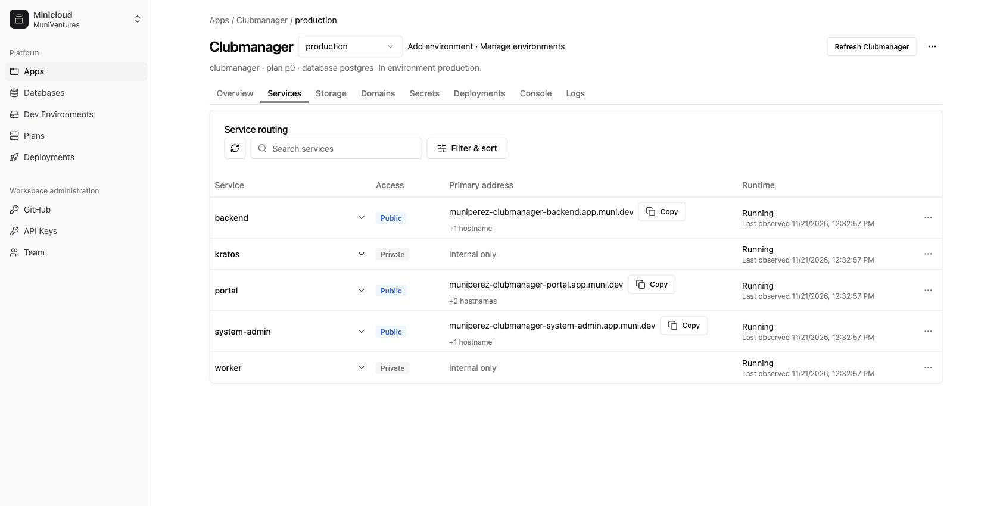
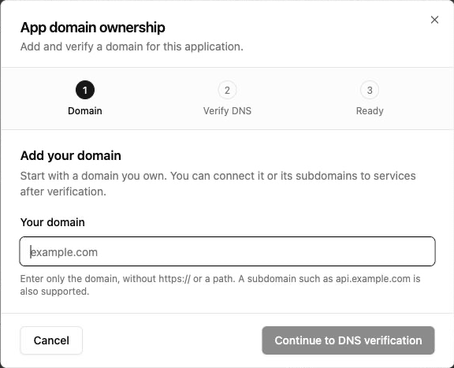
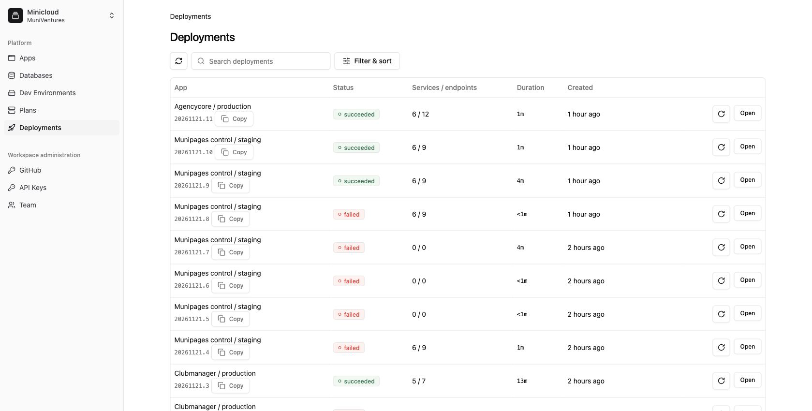

# MiniCloud

MiniCloud is a self-hosted platform for **agentic cloud coding environments and application hosting**. Work alongside a coding agent in a browser workspace, or give your agent a CLI to provision infrastructure, deploy an app, and inspect the running services on your own servers.



## How MiniCloud works

1. **Run your own instance.** Your MiniCloud dashboard and API run on a dedicated VPS. You and your agents connect the CLI to that instance to manage projects.
2. **Bring your VPS provider.** Connect a Hetzner, DigitalOcean, or Vultr account. Choose a region and server size, save them as a named plan, and MiniCloud provisions machines in that account. Your provider bills you directly.
3. **Use your own domains.** For example, host the dashboard at `cloud.example.com`, the API at `api.cloud.example.com`, and give public services addresses under `apps.example.com`. You can also attach a custom domain to an individual service.
4. **Bring your AI subscriptions.** Choose a workspace image with the coding agent you want. Sign in with your own account for that agent and use the models your provider makes available to you.



[Self-host MiniCloud](#self-host-minicloud) · [Open your first workspace](#open-your-first-workspace) · [Deploy your first app](#deploy-your-first-app)

### Open-source components

| [PostgreSQL](https://www.postgresql.org/) | [OpenBao](https://openbao.org/) | [OpenTelemetry](https://opentelemetry.io/) |
| :---: | :---: | :---: |
|  |  |  |
| Platform state and deployment jobs | Secrets storage | Optional telemetry collection |

<!-- Artwork: https://wiki.postgresql.org/wiki/Logo
     https://github.com/openbao/artwork
     https://github.com/cncf/artwork/blob/main/examples/graduated.md#opentelemetry-logos -->

The control plane also uses [Ory Kratos](https://github.com/ory/kratos) for identity and [Caddy](https://caddyserver.com/) for HTTPS. Application services run in Docker containers, and browser workspaces use [T3 Code](https://github.com/pingdotgg/t3code).

## Agentic cloud coding environments

Open T3 Code in your browser to work on a repository with a terminal and your coding agent. Your primary workspace keeps projects and session data on a retained volume so you can stop compute and pick up where you left off. The image lists its installed agents, which can include Codex, Claude Code, and GitHub Copilot CLI. Open a registered development preview from the dashboard to try the app while you work. [First workspace guide](docs/first-workspace.md)



For an independent task, launch a temporary VM from a specific Git commit. It gets its own checkout and disk. Save work you want to keep to the remote branch. Set an idle timeout to stop unused machines, or select **Keep running** for longer sessions. Retained storage continues to incur charges while compute is stopped. [Workspace controls](docs/cli.md#coding-workspaces) · [Optional T3 account linking](docs/t3-connect.md)

## Using the CLI with a coding agent

> “Deploy this change to the environment I selected and test the sign-in flow. If it fails, check the logs, fix the problem, and redeploy. Give me the working URL and tell me what you verified.”

With the project configured, your agent can run `minicloud deploy --environment <name>`. The CLI deploys changed services, waits for the result, and prints public service URLs on success. The agent can exercise a URL with your project’s tests or its browser tools. It can look up a failed build by deployment number, or read runtime logs for a particular service when a running app behaves unexpectedly. You choose the target and what counts as a successful result. [Worked CLI example](docs/agent-workflows.md)

## Application hosting

| Capability | What you can do |
| --- | --- |
| Services and builds | Run public web apps, private APIs, and workers together or update one service at a time. Build supported Node.js, .NET, and Spring Boot projects from source or deploy existing Docker images. [Deployment guide](docs/cli.md#deploy) |
| Environments and domains | Give each named environment its own services, secrets, databases, and domains. Create a preview from a Git branch. Public services get HTTPS on generated or verified custom domains, with optional Cloudflare DNS management. [Environments](docs/cli.md#named-application-environments) · [Branch previews](docs/cli.md#branch-deployments) · [Domains](docs/cli.md#service-subdomains) |
| Databases and recovery | Use SQLite or PostgreSQL with an app, or connect to shared or dedicated PostgreSQL servers. Schedule encrypted database backups, set retention, and restore a backup when needed. [Database modes](docs/cli.md#database-modes) · [Backup and restore](docs/specs/database-management-and-backups.md#backup-policy) |
| Files and assets | Keep uploaded files on expandable Hetzner volumes across deployments. Publish versioned assets separately and pin a release when a service needs a specific version. [Durable storage](docs/durable-storage.md#customer-configuration) · [Asset publishing](docs/cli.md#publish-versioned-assets) |
| Secrets and automation | Set environment variables per service, store secrets in OpenBao, and give automation scoped API keys. Deploy from the CLI or a reusable GitHub Actions workflow. [Secrets](docs/cli.md#runtime-environment-variables-and-secrets) · [GitHub Actions](docs/github-actions.md) · [API](docs/api.md) |
| Logs and operations | Follow a deployment, cancel it, or filter runtime logs by service and time. Enable OpenTelemetry log ingestion and explore application logs in Grafana. [Status and logs](docs/cli.md#status-logs-and-apps) · [Observability](observability/README.md) |

### From app to deployment

**Browse your apps and environments.** The Apps view shows each environment and its latest deployment status.



**Run multiple services in one app.** See which services have a public address, which stay internal, and whether they are running.



**Add a custom domain.** Start in the Domains tab, then verify ownership by DNS before attaching the domain to a public service.



**Monitor deployments.** Compare status, service and endpoint counts, and duration across environments.



## Get started

### Self-host MiniCloud

Run **`minicloud seed`** to set up a dedicated Ubuntu VPS. Use a [downloaded Linux candidate](docs/stateless-seed.md#download-a-candidate) or [publish the CLI from a clean clone](docs/stateless-seed.md#publish-from-a-clone), including from your own local commit. The candidate runs without Python, Git, or .NET installed on your workstation. These are **test installations**: no compatible signed server release or production migration path is available yet. Do not treat a historical CLI release as this candidate.

Have OpenSSH, a user-owned SSH key, a funded provider account, and DNS access. In the wizard, choose **`local`** to explicitly trust the executable's matching source for a test install. Review the provider quote before creating anything. Verify the host fingerprint in the provider console, approve installation, and follow the printed DNS and `/setup` instructions. Rerun the same command after a pause or interruption. [Guided setup and resume](docs/stateless-seed.md#guided-installation) · [Browser setup](docs/operator-setup.md)

### Open your first workspace

On an instance with workspace images enabled, open **Dev Environments** and choose **Create dev environment**. Name the environment, choose a size and location, and review the image, storage, and estimated cost. Creating the environment starts its primary VM. When ready, select **Connect to T3**, open the session link, and sign in to your chosen coding provider. [Workspace walkthrough](docs/first-workspace.md) · [Image setup for operators](templates/development-workspaces/README.md#prepared-image)

### Deploy your first app

Use the matching CLI you downloaded or built for your test instance. For an existing compatible instance, you can install the CLI from its pinned source revision with Git and the .NET 10 SDK. [Installation and Windows instructions](docs/cli-distribution.md)

```sh
curl -fsSL https://raw.githubusercontent.com/muniventures/minicloud/main/install.sh |
  MINICLOUD_INSTALL_MODE=source sh
```

In your app’s repository, replace the hostname below with your dashboard host. Sign in through the browser, then use `init` to select or create the app and write its `minicloud.yml`.

```sh
minicloud instance add personal cloud.example.com
minicloud login
minicloud init
minicloud deploy
```

The default local build uses Docker with Buildx. In a standard coding workspace without Docker, use `minicloud deploy --build-mode source` to build on the server. If the app has multiple environments, add `--environment <name>`. Open the service URL printed by the CLI to try the deployment. [App configuration](docs/cli.md#create-a-deployment-config) · [Build and deploy options](docs/cli.md#deploy)

## Develop from source

Use .NET 10, Node.js 22 and Docker with Compose. From the repository root:

```sh
dotnet test Minicloud.slnx --configuration Release -m:1
npm --prefix modules/dashboard ci
npm --prefix modules/dashboard test
npm --prefix modules/dashboard run build
dotnet run --project modules/cli -- --help
```

Some integration tests require Docker. Start local PostgreSQL and OpenBao with `docker compose -f compose.dev.yml up -d postgres openbao openbao-init`. This Compose file is for development only.

[Licensing](docs/licensing.md) · [Report a vulnerability](SECURITY.md)
